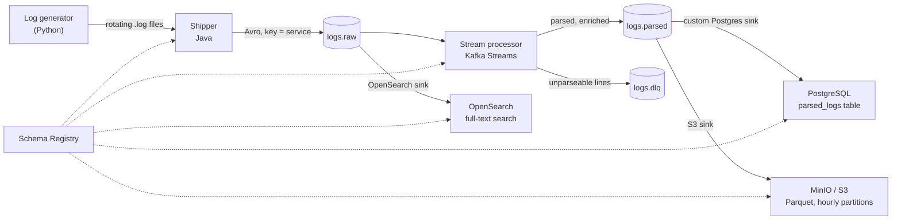

# log-aggregator

A log aggregation pipeline built on Kafka, Kafka Streams and Kafka Connect. It tails log files from several services, turns each line into a typed event, and delivers the events to search (OpenSearch), a relational database (PostgreSQL) and object storage (S3/MinIO), with monitoring and alerting along the way.

Everything runs locally with Docker Compose. The Java code is split into four Gradle modules: a shipper, a stream processor, a custom Kafka Connect sink connector and the shared Avro model. Together they hold 72 JUnit tests.

---

## Architecture



Every component reads and writes Avro through Schema Registry. Prometheus scrapes all JVMs and the broker; Grafana shows the dashboard and raises the alert.

| Topic | Partitions | Written by | Read by |
|---|---|---|---|
| `logs.raw` | 6 | Shipper | Stream processor, OpenSearch sink |
| `logs.parsed` | 6 | Stream processor | PostgreSQL sink, S3 sink |
| `logs.dlq` | 6 | Stream processor (parse failures) | Manual inspection |
| `logs.connect-dlq` | auto | Kafka Connect (records a sink could not convert) | Manual inspection |

---

## Components

### 1. Log generator (`generator/generate.py`)

Simulates a fleet of services, each writing its own rotating log file (about 1 MB per file, 3 backups). Odd-numbered services write JSON lines and even-numbered ones write plain text, so the processor has to handle both. About 30% of lines carry a trace ID, and `--malformed-pct` injects broken lines to exercise the dead-letter path.

### 2. Shipper (`shipper/`)

Watches a directory, starts one tailer per file matching `FILE_GLOB`, and publishes every new line to `logs.raw`.

- **Handles rotation and truncation:** detects a rotated file by its file key (inode), drains the old file, then reopens the new one. A file that shrinks is treated as truncated and re-read from the start.
- **Safe producer settings:** `acks=all`, idempotence on, LZ4 compression, and batching tuned through `linger.ms` and `batch.size`.
- **Per-service ordering:** the record key is the service name, so each service's lines stay in order within one partition.
- **Health endpoint:** `GET /health` on port 8090 returns `200 ok` or `503 unhealthy`.

### 3. Stream processor (`processor/`)

A Kafka Streams topology from `logs.raw` to `logs.parsed`:

1. **Parse:** JSON lines and plain-text lines (`2026-11-19 10:15:02,123 INFO [service-2] host-1 ... status=200 latency_ms=34`) both become `ParsedLogEvent`, with `status_code` and `latency_ms` pulled out when present.
2. **Branch:** lines that fail to parse go to `logs.dlq` as a `DeadLetterEvent` (stage, error, original line). They are never silently dropped.
3. **Enrich:** adds `region` and `env`.
4. **Filter:** drops `DEBUG` lines from services listed in `NOISY_SERVICES`.
5. **Sample:** keeps only a fraction (`SAMPLE_RATE`) of one high-volume service and marks those events `sampled=true`, so counts can be scaled back up downstream.

Runs with two stream threads, at-least-once processing, and a log-and-continue handler for records that cannot be deserialised.

### 4. Sinks (Kafka Connect)

| Sink | Reads | Connector | What lands |
|---|---|---|---|
| OpenSearch | `logs.raw` | Aiven OpenSearch sink | Raw events with Kafka partition and offset added, indexed with an explicit template (`level`, `service` as keywords; `message` as text) |
| PostgreSQL | `logs.parsed` | **Custom, in this repo** | Rows in `parsed_logs`, indexed on `(service, event_time)` |
| S3 (MinIO) | `logs.parsed` | Confluent S3 sink | Snappy-compressed Parquet files under `parsed/year=/month=/day=/hour=/`, partitioned by event time |

All three route records they cannot convert to `logs.connect-dlq`, with the error in the record headers.

### 5. Custom PostgreSQL sink connector (`postgres-sink-connector/`)

This connector is written from scratch against the Kafka Connect API (`SinkConnector`, `SinkTask`, `ConfigDef`). The main design choices:

- **Idempotent writes.** The primary key is the record's Kafka coordinates, `(kafka_topic, kafka_partition, kafka_offset)`, and inserts use `ON CONFLICT DO NOTHING`. If Connect redelivers records after a retry or a rebalance, they are skipped instead of duplicated. Duplicates are counted as a metric.
- **One transaction per `put()`.** Each batch commits fully or rolls back fully, so a failure never leaves half a batch in the table.
- **Retry classification.** Connection, transaction-rollback, resource and shutdown errors (SQLSTATE classes `08`, `40`, `53`, `57`) and JDBC transient exceptions are retried. Anything else, such as a constraint or data error, fails the task immediately instead of retrying forever.
- **Exponential backoff.** Retries throw `RetriableException` and call `context.timeout()`, so Connect redelivers the same batch after `retry.backoff.ms × 2^attempt`, capped at 30 s, for up to `max.retries` attempts.
- **Own metrics.** Micrometer counters for rows written, duplicates skipped, retries and failures, plus an end-to-end latency timer (event time to row written), served for Prometheus on port 7075.
- **Self-contained plugin.** `./gradlew :postgres-sink-connector:installPlugin` packages the connector with only the dependencies the Connect worker doesn't already provide.

Configuration keys: `connection.url`, `connection.user`, `connection.password`, `table.name`, `batch.size`, `max.retries`, `retry.backoff.ms`, `auto.create`, `metrics.enabled`, `metrics.port`.

### 6. Observability

- **Metrics:** Prometheus JMX exporter agents on the broker, Connect, shipper and processor, plus `kafka-exporter` for consumer-group lag.
- **Grafana dashboard** (provisioned automatically) with these panels:
  - ingest rate
  - consumer lag per group
  - end-to-end latency p50 and p99
  - DLQ rate
  - connector task state
  - JVM heap
- **Alert:** `ConsumerLagHigh` fires when any consumer group stays more than 1,000 records behind for 2 minutes. It posts to a local webhook receiver, so you can see the alert payload.

---

## Quick start

**Prerequisites:** Docker with about 8 GB of memory available, JDK 21, Python 3.12, `make`, `curl` and `jq`.

```bash
# 1. One-time setup: download the JMX exporter agent and build the custom connector plugin
make jmx-agent
./gradlew :postgres-sink-connector:installPlugin

# 2. Start the stack. Topics are created and the OpenSearch sink is registered automatically.
make up

# 3. In a second terminal, start generating logs (writes to data/logs, which the shipper tails)
make gen

# 4. Register the PostgreSQL and S3 sinks
make pg-connector-up
make s3-connector-up

# 5. Check that data is flowing
make verify        # health checks for the OpenSearch path
make os-count      # documents in OpenSearch
make pg-count      # rows in PostgreSQL (rows and distinct offsets should match)
make s3-ls         # Parquet files in MinIO
```

| UI | URL | Login |
|---|---|---|
| Kafka UI | http://localhost:8080 | – |
| Grafana | http://localhost:3000 | admin / admin |
| Prometheus | http://localhost:9090 | – |
| OpenSearch Dashboards | http://localhost:5601 | – |
| MinIO console | http://localhost:9001 | minioadmin / minioadmin |
| Kafka Connect REST | http://localhost:8083 | – |
| Schema Registry | http://localhost:8081 | – |
| Shipper health | http://localhost:8090/health | – |

Stop with `make down`. Use `make clean` to also delete all data volumes.

---

## Useful commands

| Command | What it does |
|---|---|
| `make build` / `make test` | Build all modules / run all JUnit tests |
| `make gen-load RATE=5000` | Generate high-volume logs with bursts across 8 services |
| `make logs S=processor` | Follow one container's logs |
| `make pg-plugin` | Rebuild the custom connector and restart Connect |
| `make pg-connector-status` / `make s3-connector-status` | Connector and task state |
| `make pg-shell` | Open `psql` on the logs database |
| `make s3-cat KEY=<path>` | Download one Parquet file from MinIO |
| `make connector-status` | OpenSearch connector state |

---

## Configuration

Both services read their settings from environment variables. Defaults suit the Compose setup.

**Shipper**

| Variable | Default | Purpose |
|---|---|---|
| `KAFKA_BOOTSTRAP` | `localhost:9092` | Kafka brokers |
| `SCHEMA_REGISTRY_URL` | `http://localhost:8081` | Schema Registry |
| `LOGS_TOPIC` | `logs.raw` | Target topic |
| `FILE_GLOB` | `*.log` | Files to tail in directory mode |
| `START_AT_END` | `false` | Skip existing content in files when starting |
| `POLL_INTERVAL_MS` / `SCAN_INTERVAL_MS` | `200` / `5000` | How often to read files and look for new ones |
| `PRODUCER_LINGER_MS` / `PRODUCER_BATCH_SIZE` | `20` / `65536` | Producer batching |
| `PRODUCER_COMPRESSION` | `lz4` | `none`, `gzip`, `snappy`, `lz4` or `zstd` |
| `HEALTH_PORT` | `8090` | Health endpoint port |

**Processor**

| Variable | Default | Purpose |
|---|---|---|
| `INPUT_TOPIC` / `PARSED_TOPIC` / `DLQ_TOPIC` | `logs.raw` / `logs.parsed` / `logs.dlq` | Topics |
| `STREAMS_APPLICATION_ID` | `log-processor` | Consumer group and state prefix |
| `STREAM_THREADS` | `2` | Stream threads |
| `ENRICH_REGION` / `ENRICH_ENV` | `local` / `dev` | Values added to each event |
| `NOISY_SERVICES` | `service-3` | Services whose `DEBUG` lines are dropped |
| `SAMPLE_SERVICE` / `SAMPLE_RATE` | `service-4` / `0.1` | Service to sample and the fraction kept |

Connector settings live in `infra/connectors/*.json`.

---

## Testing

```bash
./gradlew test     # unit tests, all modules
./gradlew build    # unit + integration tests (needs Docker for Testcontainers)
```

| Module | Tests | Covers |
|---|---|---|
| `shipper` | 30 | Config parsing, file tailing with rotation and truncation, producer, health server, tailer manager |
| `postgres-sink-connector` | 28 | Config validation, task retry logic (Mockito), SQL binding, metrics. Plus a Testcontainers PostgreSQL integration test proving rows land exactly once after a forced retry and a redelivery, and that a fatal error rolls back the whole batch. |
| `processor` | 14 | JSON and text parsing, sampling, and the full topology with `TopologyTestDriver` |

GitHub Actions runs the full build on every push and pull request, and uploads the packaged connector plugin as a build artifact.

---

## Design decisions

- **Avro with Schema Registry, not JSON.** Schemas are enforced at the producer, records are smaller on the wire, and the sinks get typed fields without guessing. Compatibility is checked when a schema changes.
- **Raw and parsed topics are separate.** OpenSearch indexes every raw line, including ones the processor can't parse, so nothing is unsearchable. PostgreSQL and S3 only get clean, typed records.
- **Dead-letter topics at two levels.** Parse failures go to `logs.dlq` from the processor. Conversion failures inside Connect go to `logs.connect-dlq`. In both cases bad records are kept for inspection instead of stopping the pipeline.
- **Idempotency in the sink, not exactly-once in the stream.** The processor runs at-least-once, which is simpler and faster. Duplicates are removed where they would do harm, in the database, by keying on Kafka coordinates.
- **Parquet partitioned by event time in S3.** Columnar files with hourly partitions are what a query engine such as Athena or Spark would read later.

---

## Project layout

```
log-aggregator/
├── model/                    Avro schemas: LogEvent, ParsedLogEvent, DeadLetterEvent
├── shipper/                  File tailer + Kafka producer (Java 21)
├── processor/                Kafka Streams topology (Java 21)
├── postgres-sink-connector/  Custom Kafka Connect sink + tests
├── generator/                Python fake log generator
├── infra/
│   ├── compose.yaml          Full local stack
│   ├── connectors/           Sink connector configs
│   ├── connect/              Connect image with OpenSearch and S3 plugins
│   ├── grafana/              Dashboard, data source, alert rule
│   ├── prometheus/           Scrape config
│   ├── jmx/                  JMX exporter rules
│   ├── opensearch/           Index template
│   └── scripts/              Connector registration and verification
├── Makefile
└── .github/workflows/ci.yml
```

---

## Limitations and next steps

This is a local, single-machine setup built for learning and demonstration. Known limits:

- **Single broker, replication factor 1.** No fault tolerance at the Kafka level yet.
- **Shipper file positions are not saved.** After a restart, the shipper re-reads files from the start unless `START_AT_END=true`. Re-shipped lines get new offsets, so the sink's offset-based de-duplication doesn't catch them.
- **Credentials are plain text** in Compose and connector configs. That's fine for local development, not for anything shared.
